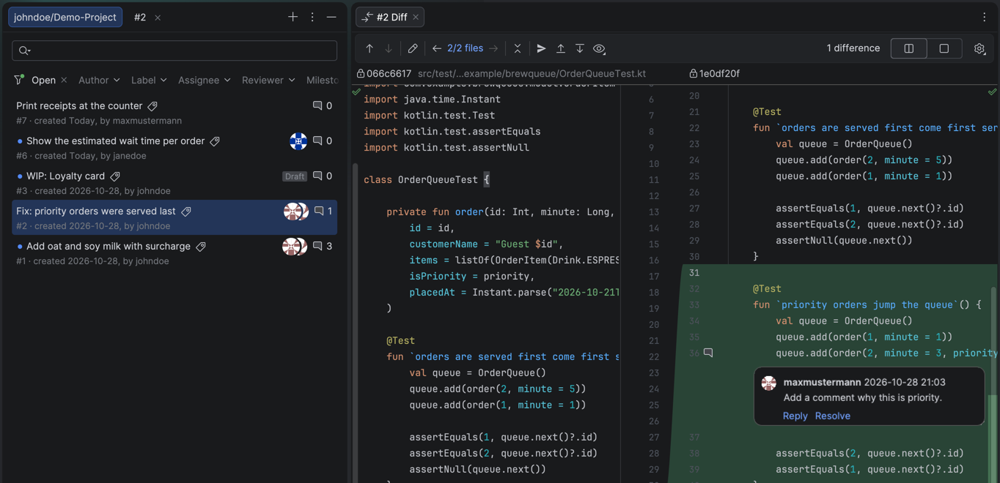
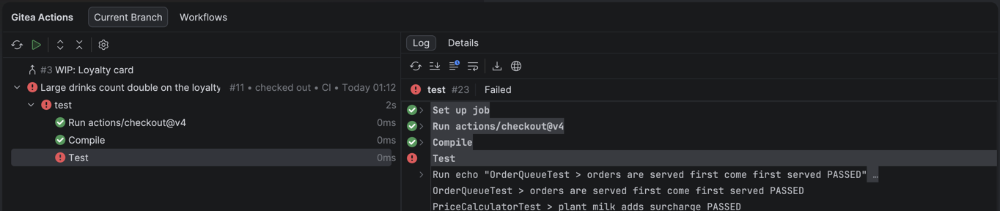
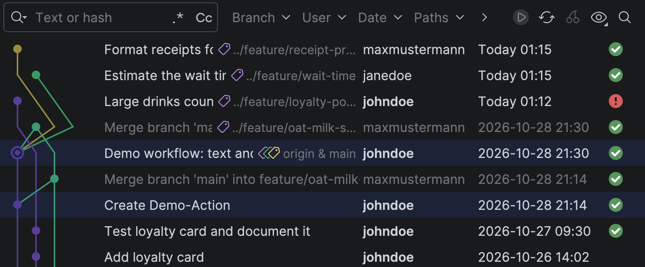

*Gitea Pull Requests & Actions* brings your Gitea server into IntelliJ-based IDEs. Review and merge pull requests the way the
bundled GitHub and GitLab plugins do, follow Gitea Actions runs in their own tool window, and keep the rest of your Gitea
work in the IDE as well.

The plugin is an independent project and is not affiliated with or endorsed by Gitea. It needs the Git plugin
and Gitea 28 or newer.

## Pull requests

Browse, review, create and merge pull requests without switching to the browser. Comment inline in the diff or in the
editor, reply to threads, approve or request changes, and merge with the style your repository allows.

**→ [More about pull requests](pull-requests)**

## Gitea Actions

See the runs of your current branch, of every workflow and of each pull request, with jobs, steps and live logs. Re-run,
cancel, start `workflow_dispatch` workflows on Gitea, or run a job locally in Docker.

**→ [More about Gitea Actions](actions)**

## Integrations

Log in with OAuth or an access token, clone repositories, see the checks of every commit in the Git log, give AI
assistants read access to pull requests and runs through the IDE's MCP server, and work on Gitea issues as tasks.

**→ [More about integrations](integrations)**
