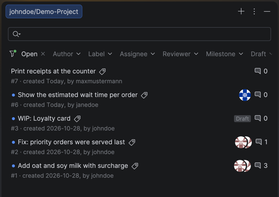
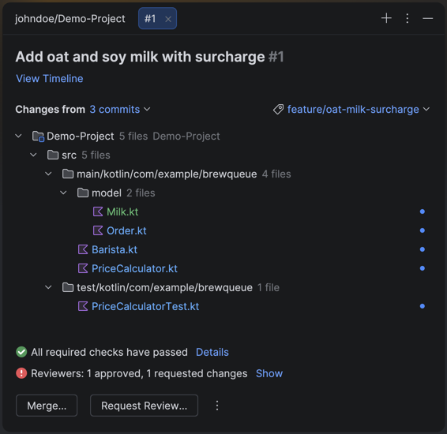
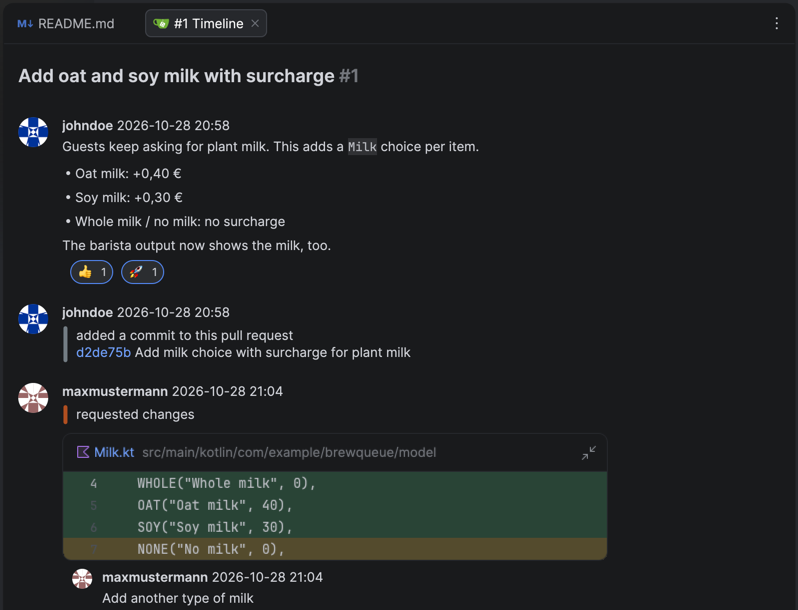
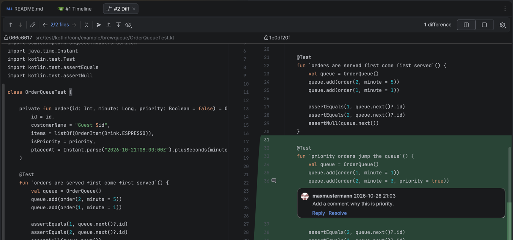
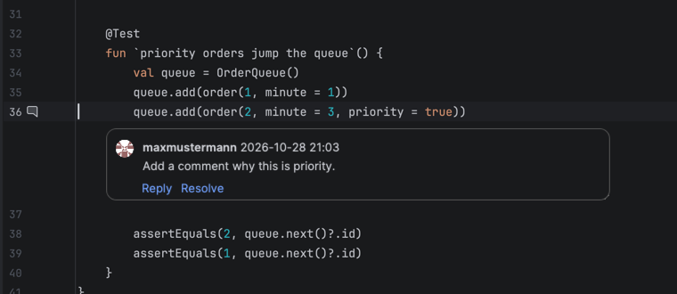
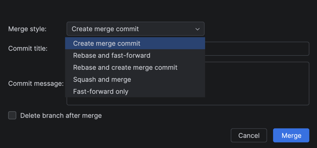
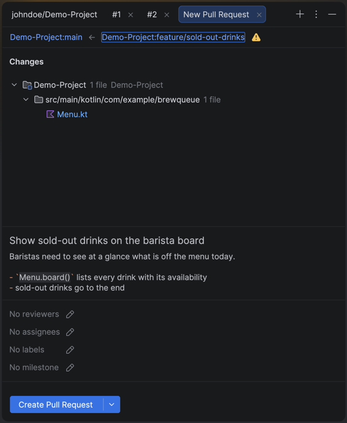

Everything about pull requests lives in the **Gitea Pull Requests** tool window and in editor tabs, just like in the
bundled GitHub and GitLab plugins.

## Find the pull request you need

The list shows the open pull requests of the repository with their labels, reviewers and comment count. Filter by state,
author, label, assignee, reviewer, milestone or draft, or search by text.

## Details at a glance

Open a pull request to see its branch, commits and changed files. Below the files you see the state of the CI checks,
whether the branch is behind its base, and how the reviewers decided. Merge, request a review or open more actions from
the same panel.

## The full conversation

**View Timeline** opens the conversation in an editor tab: the description with reactions, commits, reviews, and review
threads with the code they refer to. Reply, react or resolve threads right there.

## Review in the diff

Open a changed file to get the IDE's diff viewer. Existing comments appear inline. Add comments, suggest changes, reply,
resolve, and mark files as viewed. When you are done, submit your review: comment, approve or request changes.

## Review in the editor

Check out a pull request and its review threads also show up in the regular editor, so you can read and answer them
while you work on the code.

The branch widget shows which pull request belongs to the current branch.

## Merge

Merge with any style the repository allows: merge commit, rebase, rebase with merge commit, squash or fast-forward.
Optionally set the commit title and message, and delete the branch afterwards. When checks are still running, the
pull request can also merge automatically once they pass.

## Create pull requests

Create a pull request from the current branch: pick the base branch, check the changes, write title and description,
and set reviewers, assignees, labels and milestone. If the branch is not pushed yet, the plugin pushes it for you.

## And more

- Check out the branch of a pull request.
- Close, reopen, mark as draft or ready, and update the branch from its base.
- Push notifications link to the pull request of the pushed branch.
