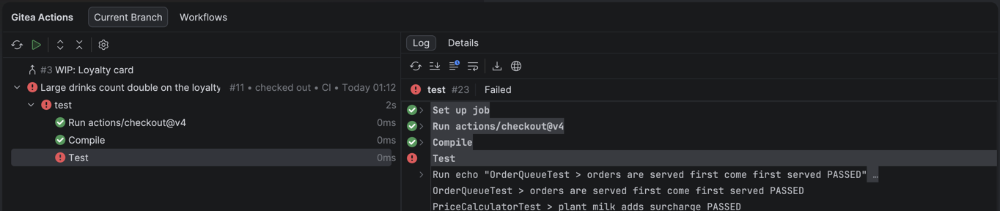
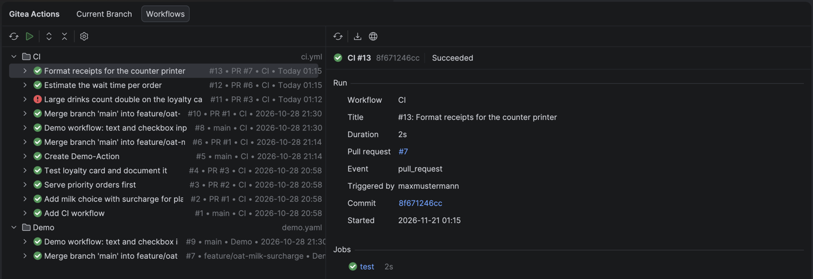
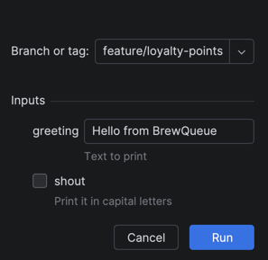
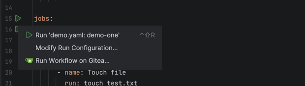
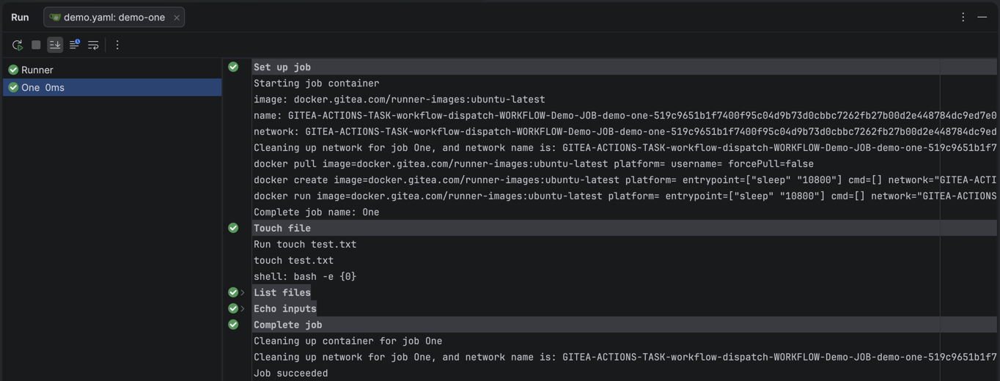
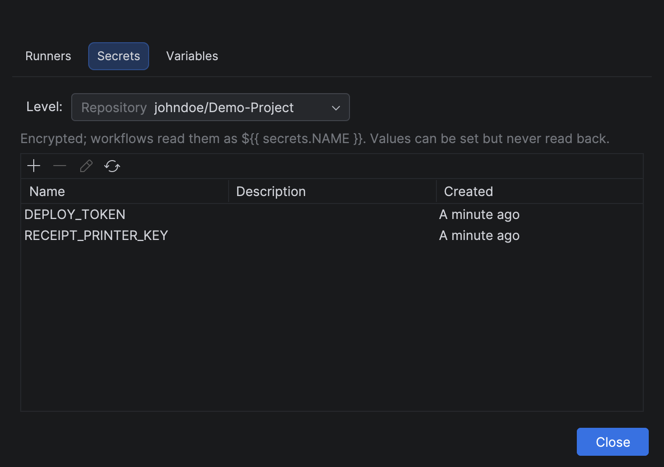

The **Gitea Actions** tool window shows your workflow runs with their jobs, steps and logs, so you see why a check
failed without opening the browser.

## Runs of the current branch

The **Current Branch** tab lists the runs of the branch you have checked out, including those of its pull request.
Select a job or step to read its log, grouped by step like on Gitea and updated live while the job runs. Re-run all
jobs, only the failed ones or a single job, cancel a run, and download artifacts and logs.

## Every workflow

The **Workflows** tab groups all runs by workflow file. The details panel shows the event, the commit, who triggered
the run, its duration and its jobs.

## Run workflows manually

Start a workflow with a `workflow_dispatch` trigger from the tool window. Pick the branch or tag and fill in the
inputs. Text, choice and boolean inputs get matching fields.

## Right from the workflow file

Workflow files get play icons next to `jobs:` and each job. Run the workflow on Gitea, or run a job locally.

## Run jobs locally

Local runs use `gitea-runner exec`, in Docker or with a runner binary you choose. The log is shown by job and step,
just like a run on Gitea. Event, inputs, secrets, variables and an `.env` file can be set in the run configuration.

## Always in view

A status bar widget shows the state of the current branch's runs, and a notification tells you when a run has
finished.

## Runners, secrets and variables

Repository admins can see the runners available to the repository and manage the Actions secrets and variables.
Secret values can be set but never read back.

