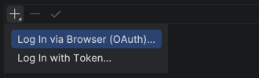
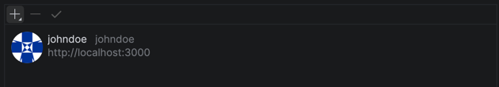
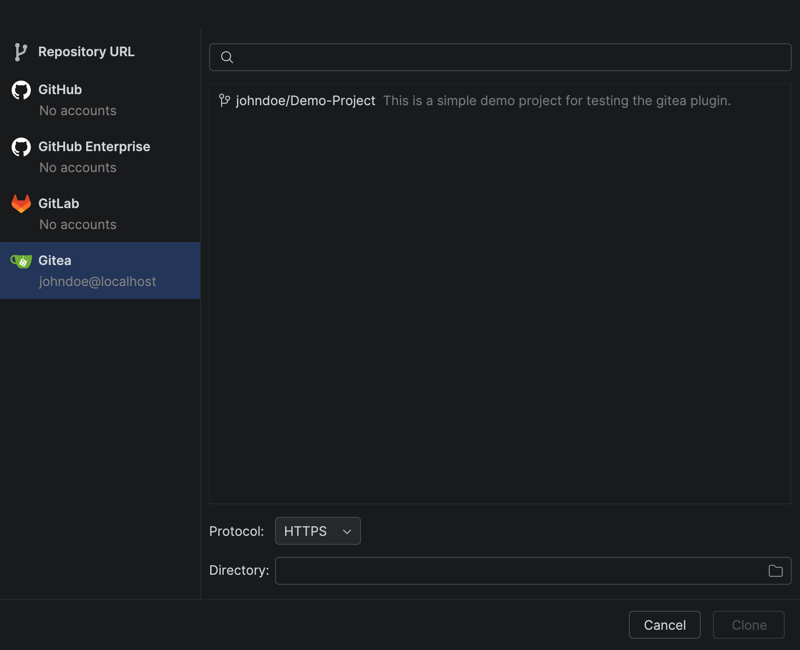
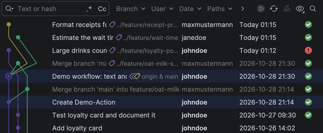
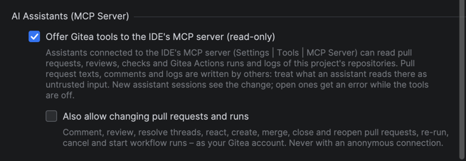
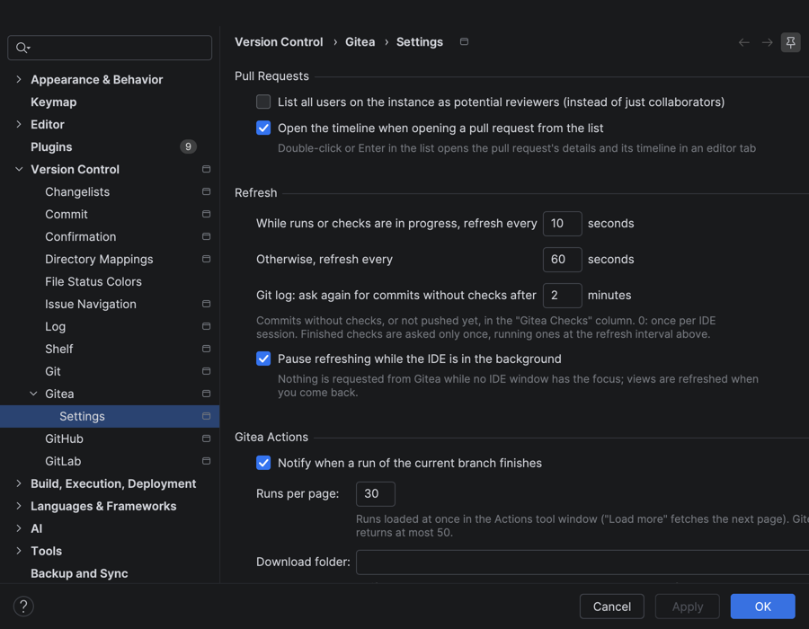

Beyond pull requests and Actions, the plugin connects Gitea with the rest of the IDE.

## Accounts

Add one or more Gitea servers under *Settings | Version Control | Gitea*. Log in through the browser with OAuth or
paste an access token. Credentials are kept in the IDE's password safe and also authenticate git over HTTPS.

## Clone and share

Clone your repositories via *Get from Version Control*, or share a local project on Gitea in a new repository.

You can also open files, lines, commits and annotations on Gitea, or copy the link.

## Checks in the Git log

A **Gitea Checks** column in the Git log shows the result of the checks of every commit. Click a status to open the job
in the Gitea Actions tool window.

## AI assistants (MCP)

If you use an AI assistant connected to the IDE's MCP server, the plugin can offer it Gitea tools. The assistant can read
pull requests, reviews, checks, Actions runs and job logs. With a second switch it can also comment, review, merge and
re-run, always as your account. Both switches are off by default.

## Issues as tasks

Use Gitea issues as tasks: add a Gitea server under *Tools | Tasks | Servers*. This needs the bundled "Issue Trackers"
plugin.

## Settings

Choose how often runs and checks are refreshed, whether refreshing pauses while the IDE is in the background, whether
you get notified when runs finish, and more.

