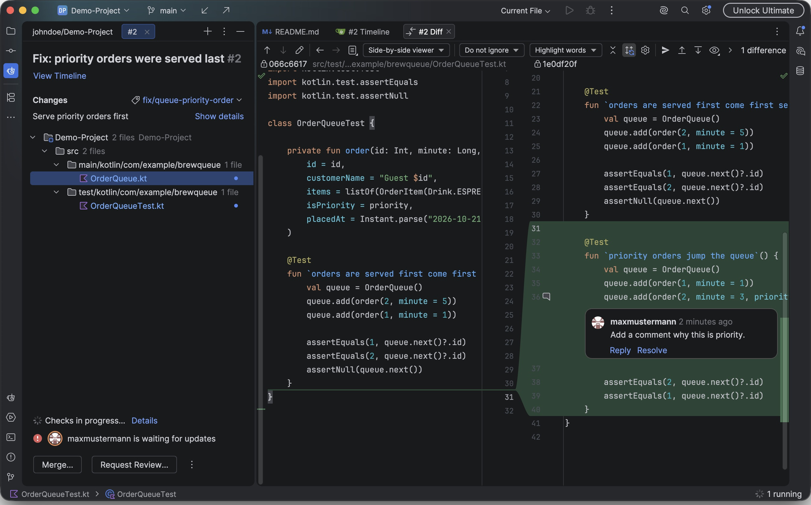
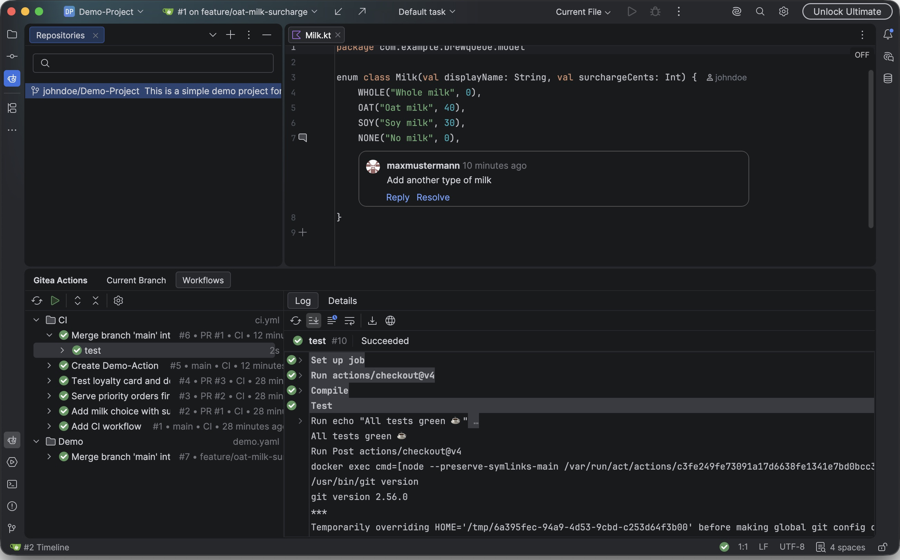
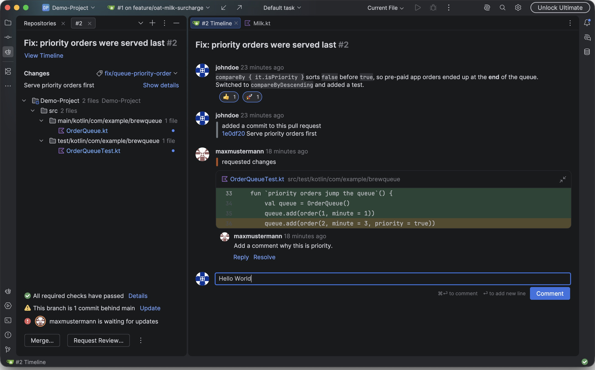
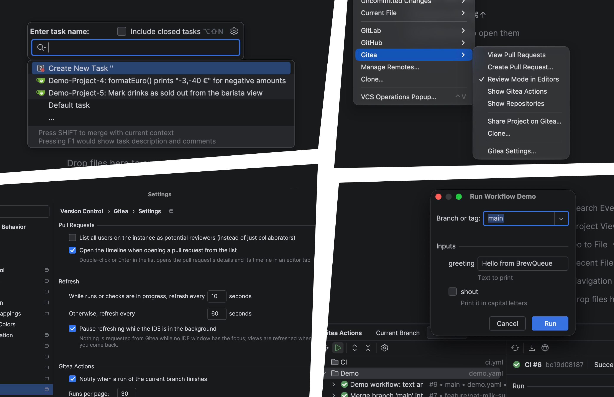

<p align="center">
  
  
  
  <br /><br />
  <a href="https://plugins.jetbrains.com/plugin/35606-gitea-pull-requests--actions/">Get plugin on Jetbrains Marketplace</a>
</p>

# Gitea Pull Requests & Actions - Plugin for IntelliJ

Unofficial plugin for IntelliJ to review Pull Requests, view actions and work with Gitea.

> [!NOTE]
> This project was built to a large extent with AI assistance, using [Claude Code](https://claude.com/claude-code).
> All changes were reviewed by a human, and the plugin has been tested against a production Gitea server.

<!-- Plugin description -->
Work with [Gitea](https://about.gitea.com) without leaving the IDE: pull requests and code review like the bundled
GitHub and GitLab plugins, plus **Gitea Actions** in their own tool window.

**Accounts and repositories**
- Log in to one or more Gitea servers with OAuth in the browser or an access token; credentials stay in the IDE's
  password safe and also authenticate git over HTTPS.
- Clone repositories (*Get from Version Control*) and share projects on Gitea.
- Open files, lines, commits and annotations on Gitea, or copy the link.

**Pull requests**
- List with filters and search, details with reviewers, labels, CI checks and the full timeline.
- Review in the diff or right in the editor: inline comments, suggested changes, replies, reactions, approve or
  request changes; mark files as viewed.
- Create pull requests (with push), check out their branches, merge, rebase, squash or auto-merge when checks pass,
  close, reopen, mark as draft, update the branch.
- The branch widget and push notifications show the pull request of the current branch.

**Gitea Actions**
- Runs of the current branch, of every workflow and of a pull request, with jobs, steps and live logs.
- Re-run all, failed or single jobs, cancel runs, download artifacts and run logs.
- Run workflows manually (`workflow_dispatch`), also from the play icons in the workflow file – on Gitea or locally
  in Docker with `gitea-runner exec`.
- Status bar widget, finish notifications, repository secrets and variables.

**Issues**
- Gitea issues as tasks (*Tools | Tasks | Servers*, needs the bundled "Issue Trackers" plugin).

---

Requires the Git plugin and Gitea 28 or newer. Not affiliated with the Gitea project.
<!-- Plugin description end -->

## Tips

**`#123` links in commit messages:** add an entry under *Settings | Version Control | Issue Navigation* –
issue ID `#(\d+)`, issue link `https://<your gitea>/<owner>/<repo>/issues/$1`. The plugin doesn't add it
itself: the setting is only reachable through an internal IDE module.

## Screenshots

<a href=".readme/Screenshot1.jpeg">
  
</a>

<a href=".readme/Screenshot2.jpeg">
  
</a>

<a href=".readme/Screenshot3.jpeg">
  
</a>

<a href=".readme/Screenshot4.jpeg">
  
</a>

## Building

Requires a JDK (17+ to run Gradle; the JDK 21 toolchain is downloaded automatically).

```bash
./gradlew build          # compile + unit tests
./gradlew runIde         # sandbox IDE with the plugin
./gradlew verifyPlugin   # IntelliJ Plugin Verifier
./gradlew buildPlugin    # zip in build/distributions
```

Integration tests run against a real Gitea. `.github/scripts/ci-gitea.sh` starts a fresh one (no Docker needed),
creates the test users `intellij-dev` / `intellij-reviewer` and seeds the test repositories:

```bash
.github/scripts/ci-gitea.sh min /tmp/gitea-ci 3300
GITEA_TEST_ENV=/tmp/gitea-ci/gitea-test.env GITEA_TEST_NO_RUNNER=1 ./gradlew integrationTest
.github/scripts/ci-gitea.sh stop /tmp/gitea-ci
```

Without an Actions runner, the tests that need finished runs are skipped. To test against your own Gitea, put the same
keys into `gitea-test.local.env` in the repository root (git-ignored) and run `./gradlew integrationTest`.

## Licence

MIT – see [LICENSE](LICENSE). The Gitea logo is © The Gitea Authors, MIT licence – see [NOTICE](NOTICE).
